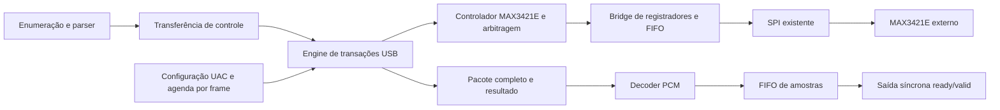
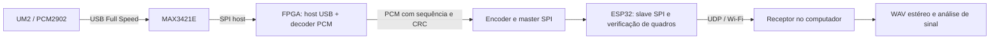

# USB Audio Host: arquitetura e critérios de revisão

Para uma descrição didática do circuito RTL, pinagem do shield, LEDs e
procedimento/histórico do SignalTap, consulte o
[guia técnico de bring-up](technical_guide.md). O diagnóstico do enlace
FPGA→ESP32→UDP e as medições da sessão física estão em
[`esp32_spi_audio_postmortem.md`](esp32_spi_audio_postmortem.md).

## Escopo e evidência

Aquisição inteiramente em RTL, sem processador para a stack USB. O dispositivo
observado é `08bb:2902`; os descritores completos estão em
`hardware/um2/`. Perfil inicial: configuração 1, interface 2, alternate 1,
endpoint `0x84`, PCM estéreo S16_LE, 48 kHz, intervalo de 1 frame, máximo
196 bytes por pacote. Esse máximo é anunciado pelo descritor; não foi medido
em uma captura USB. A seleção de frequência deste alternate é fixa e seu
descritor de endpoint não anuncia controle de frequência: não enviar SET_CUR
sem evidência de suporte. A leitura do datasheet não substitui a caracterização.

## Camadas

## Caminho PCM até o backend

A stack USB, enumeração, agendamento ISO e reconstrução PCM são RTL na FPGA.
O ESP32 não executa USB: recebe os quadros PCM já decodificados pela SPI,
verifica cabeçalho/CRC/sequência e os encaminha por UDP ao receptor do
computador. O LEDR4 confirma que a FPGA aceitou ao menos uma amostra; CRC,
sequência e contadores do ESP32 verificam o enlace SPI; o receptor e a análise
de tons conhecidos verificam o conteúdo recebido no computador.

O caminho FPGA → ESP32 → UDP foi exercitado fisicamente em 2026-11-03; o usuário
confirmou captura WAV funcional. Parâmetros e diagnóstico do enlace estão em
[`esp32_spi_audio_postmortem.md`](esp32_spi_audio_postmortem.md). A simulação
continua sendo evidência separada. Não houve captura usbmon/URB; qualidade de
áudio com tom calibrado não foi medida.

Todos os blocos internos usam `clk_i` de 50 MHz e reset síncrono ativo baixo
`rst_ni`. INT externo precisa de sincronizador de dois estágios; MISO é dado
síncrono ao SPI, sujeito às constraints de entrada/saída. Reset físico e KEY
precisam de tratamento no top de placa. A saída inicial é no mesmo domínio de
50 MHz: qualquer consumidor em outro domínio exige FIFO CDC adicional e
verificação específica. Não declarar CDC implementado por usar um FIFO síncrono.

## Contratos aprovados para implementação

* Bridge: requisição `valid/ready`, endereço de registrador de 5 bits,
  direção, tamanho de 7 bits (1–64) e 512 bits de dados. Resposta
  `valid/ready`, 512 bits e erro. Byte zero em `[7:0]`. Uma requisição produz
  um único CS contendo comando e dados. Comprimentos inválidos não acessam SPI.
* Engine: token HXFR, endereço USB, payload de até 64 bytes e opção explícita
  de inicialização de toggle. Resposta atômica: pacote de até 256 bytes,
  comprimento de 9 bits e resultado HRSL. Drenar bancos de 64 bytes antes
  da conclusão do pacote. Não publicar amostras de pacotes depois considerados
  inválidos pelo resultado final.
* Controle: SETUP de 64 bits na ordem de bytes USB, endereço e tamanho EP0;
  stream de dados IN com handshake e conclusão somente após status. Enumeração
  deve aceitar dados do EP0 de 8 bytes em múltiplas transações, inclusive os
  1191 bytes do descritor de configuração observado.
* Parser: stream limitado por `wTotalLength`, validação de comprimentos e
  associação entre interface, alternate, formato e endpoint. Não identificar
  suporte apenas pelo VID/PID ou por um endereço de endpoint fixo.
* Decoder: pacote de 2048 bits, comprimento de 9 bits e erro; saída de 32 bits
  `{right[15:0],left[15:0]}`, `valid/ready`, estável sob backpressure. Descartar
  pacotes inválidos ou cujo tamanho não seja múltiplo de quatro. `flush_i`
  remove dados antigos na desconexão.
* Buffer: FIFO síncrono parametrizado, handshake de 32 bits, ocupação e pico
  explícitos. Consumidor pronto com FIFO vazio não é, por si só, underflow.

## Perfil padrão e expansão

O top usa VID/PID UM2 `08bb:2902`, PCM Type I estéreo S16_LE a 48 kHz e
intervalo isócrono de 1 ms por padrão. VID, PID, taxa-alvo, endpoint desejado,
e limites de tamanho de pacote são parâmetros de `usb_audio_host_top`. Endpoint
zero seleciona automaticamente um endpoint isócrono IN que corresponda ao
perfil; os descritores reais da UM2 selecionam `0x84`, alternate 1. A seleção
rejeita `wMaxPacketSize` acima de 256 bytes, limite da memória de pacote do
engine.

A extensão atual é deliberadamente de perfil: o decoder ainda produz pares
estéreo S16 e o scheduler solicita um pacote a cada SOF de 1 ms. Suportar mono,
outra resolução de amostra, subslot, `bInterval` diferente de 1, endpoint acima
de 256 bytes ou hubs exige ampliar o decoder/normalizador, agenda, buffers ou
alocação de endereço correspondentes. Esses limites são explícitos e
parametrizados onde há suporte; não se declara compatibilidade universal com
todo dispositivo UAC.

O controlador possui o barramento durante inicialização e monitoração ociosa.
O engine mantém um lock durante cada transação; nenhum outro cliente pode
limpar HIRQ ou drenar FIFO nesse intervalo. RCVDAV tem prioridade sobre outras
interrupções. Conclusão e RCVDAV simultâneos exigem drenar todos os bancos antes
de encerrar a resposta. Desconexão cancela o controle, invalida o pacote e
limpa decoder e buffer antes de nova enumeração.

## Orçamento temporal inicial

O datasheet permite SPI até 26 MHz; o divisor zero do núcleo existente produz
25 MHz a partir de 50 MHz. O guia de programação, pp. 15–16, descreve os dois
bancos de 64 bytes e a concatenação ISO. Sua seção ISO-IN contém inconsistências
editoriais (OUT token/SNDBAV); confrontar com a tabela HXFR e descrição de RCVDAV,
que definem ISO IN e liberação do banco por W1C de RCVDAV.

O USB Full Speed entrega no máximo 12 Mbit/s. Sem bit stuffing, 64 bytes de
payload ocupam `64*8/12e6 = 42,667 us`. Esse é o tempo conservador usado para
comparar o serviço de um banco. Com dois bancos, o overrun começa no byte 129,
65 intervalos de byte depois que o byte 64 enche o primeiro banco; usar 64
intervalos é conservador por um byte. Bit stuffing e overhead de pacote alongam
a chegada, então a cadência contínua e sem stuffing do modelo estressa o FIFO
mais cedo. Esperar HXFRDN antes de iniciar a drenagem de um pacote de 196 bytes
é incorreto.

O teste corrente da bridge mediu 1.436 ciclos (28,72 us) entre aceitação e
resposta para 64 bytes, e 50 ciclos (1,00 us) para acesso unitário. A estimativa
nominal com leitura HIRQ, leitura RCVBC, burst de 64 e W1C custa
`3*1,00 + 28,72 = 31,72 us`; essa soma não é limite superior: não inclui fase
de polling, arbitragem, estados da FSM ou atrasos físicos. No modelo integrado
com cadência USB byte a byte e RTL real de SPI/controlador/engine, o primeiro
banco foi liberado em 1.690 ciclos (33,8 us), contra o intervalo conservador de
42,667 us: margem digital de 8,867 us. Essa é a medida end-to-end mais
representativa, mas não limita todas as fases de polling nem garante o timing
do chip/shield real. O log da bridge está em
`results/protocol/bridge_current.txt`.

Vazão nominal PCM: `48000*2*2 = 192000 bytes/s`; 49 amostras estéreo cabem no
máximo de 196 bytes. Uma FIFO de 256 amostras absorve aproximadamente 5,333 ms
de parada partindo vazia, sem considerar outros estágios. Isso não permite
backpressure ilimitado sobre USB isócrono: overflow deve ser contado e marcado
como descontinuidade. Pacotes não podem ser repetidos para recuperar ISO perdido.

## Gates de aceitação e estado

1. **SPI do MAX — aprovado em simulação; SPI para ESP32 — aprovado em hardware.** `make -C tb/usb bridge` verifica comandos,
   CS, FIFO de 64 bytes, reset, comprimentos inválidos e tempos do MAX3421E;
   `make -C tb sim` cobre o adaptador SPI existente. O enlace de áudio
   FPGA→ESP32 também foi exercitado fisicamente em 2026-11-03.
2. **Inicialização/enumeração — aprovado nos modelos.** Testes de controle e
   engine exercitam descritores reais, SET_ADDRESS/status, toggles, short
   packets, timeouts e erros; o caminho de enumeração seleciona interface 2,
   alternate 1 e endpoint IN `0x84`.
3. **Bancos MAX — aprovado no modelo comportamental.** A regressão integrada
   drena pacote ISO de 196 bytes como 64+64+64+4, verifica IRQ simultânea,
   overrun e atraso SPI. A latência máxima observada para liberar o primeiro
   banco foi 33,8 us, margem de 8,867 us frente ao intervalo conservador de
   64 bytes. Ainda não é medição do chip/shield real.
4. **Streaming PCM — aprovado em simulação e caminho físico até WAV confirmado.** O3 verifica 48.000 amostras e
   recuperação de falhas; `make -C tb/usb board_long` estende a comparação,
   sequência, CRC e limite SCK até 3.428 quadros GPIO completos. Os resultados
   e hashes estão em `results/model_run.md` e `results/board_gpio_frame.md`.
   O usuário confirmou a captura WAV física; o postmortem registra os limites
   que ainda não foram medidos.
5. **Lint/síntese/STA — aprovado para os projetos digitais.** `make lint` roda Verilator nos tops `usb_audio_host_top` e
   `aces2_usb_audio_top`; o RTL do projeto não emite `WIDTHEXPAND`. A dispensa
   dessa regra está limitada aos dois arquivos do core SPI de terceiros. Os
   Quartus Prime Standard 25.1 compilou os projetos core e DE10-Lite nos hashes
   atuais; fit e STA pós-fit passaram com TNS zero. No wrapper, faltam delays
   externos de MOSI/CS do ESP32 e interconexão. Isso não é declarado como
   fechamento de timing externo nem sign-off físico.
6. **Pinagem — parcialmente aprovada.** D10 SS AB19, D11 MOSI AA19, D12 MISO
   Y19 e D13 SCK AB20 vêm do manual DE10-Lite. INT/RESET são um contrato de
   jumpers documentado. Falta identificar o shield físico específico e
   inspecionar os buffers HCT/AHC, VL, pull-ups e roteamento; não se assume uma
   variante de shield.
7. **Validação física — caminho funcional, caracterização restante.** O `.sof`
   e o firmware foram programados e usados. SignalTap mostrou enumeração e
   pacotes ISO; o ESP32 recebeu quadros completos de 512 bits com CRC válido e
   encaminhou UDP. O usuário confirmou WAV audível. VBUS foi medido em 4,8 V
   com e sem UM2. Ainda faltam esquema/revisão exata do shield, timing elétrico
   diretamente no pad ESP32, trace usbmon e avaliação com tom calibrado.

As referências locais e sua procedência estão em `references/README.md`.
