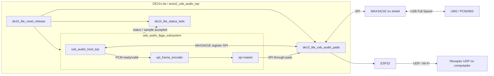
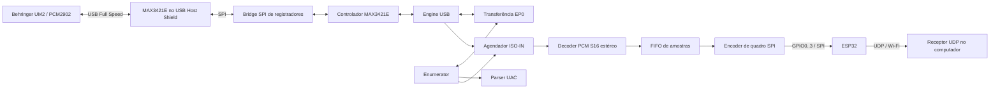

# Guia técnico: host USB de áudio na DE10-Lite

Este guia explica o circuito USB implementado em RTL, o caminho pretendido do
áudio até o ESP32, a configuração do SignalTap, os sinais observados, os erros
encontrados e o estado da validação física. Foi escrito a partir da RTL,
projetos Quartus, documentação local e capturas feitas com a FPGA e a Behringer
UM2 conectadas.

## Estado conhecido em 3 de novembro de 2026

O USB host da FPGA foi observado enumerando a UM2 e recebendo pacotes
isócronos; LEDR4 marcou a aceitação de amostra no caminho PCM. O transporte SPI
foi depois exercitado com a DE10-Lite e o ESP32 conectados. Com a configuração
final, o monitor ESP32 mostrou cerca de 3.530 quadros de 512 bits por segundo,
sem CRC inválido em regime estável. O firmware encaminhou datagramas UDP e o
usuário confirmou que conseguiu capturar e ouvir o WAV.

A captura SignalTap do primeiro pacote ISO tinha 60 bytes zero; ela é uma
captura histórica curta, não a caracterização de todo o fluxo posterior. Ainda
não há medição de resposta em frequência, distorção ou amplitude com tom
calibrado, nem trace de URB via usbmon. O diagnóstico SPI, as alterações no
ESP32/FPGA e os critérios de validação estão em
[`esp32_spi_audio_postmortem.md`](esp32_spi_audio_postmortem.md).

| Marco | Evidência atual | Estado |
|---|---|---|
| Shield e FPGA trocam SPI | MOSI, MISO, SCK e CS variam; registradores MAX3421E são lidos/escritos | Observado |
| Host inicia USB | `GET_DESCRIPTOR(Device)` é escrito em SUDFIFO e lançado por HXFR | Observado |
| Dispositivo responde ao controle | HXFRDN e HRSLT zero; depois chegam bytes de RCVFIFO | Observado |
| Identidade UM2 | Descritor contém VID `08BB`, PID `2902`, EP0 de 8 bytes | Observado |
| Endereço USB atribuído | `SET_ADDRESS(1)` conclui sem erro | Observado |
| Configuração/interface de áudio aceita | LEDR1/LEDR2 altos; `SET_INTERFACE` para interface 2, alternate 1 | Observado |
| Pacote isócrono recebido | HRSL `0x80`, RCVBC `0x3C` (60 bytes) lido de RCVFIFO | Observado |
| Amostra aceita pelo caminho PCM da FPGA | LEDR4 subiu; primeiro pacote observado contém zeros | Observado; conteúdo desse pacote específico era silêncio |
| Quadro SPI recebido no ESP32 | `trans_len=512`, CRC válido e taxa estável após intervalo CS de 100 µs | Observado fisicamente; detalhes no postmortem |
| PCM encaminhado por UDP e WAV | Contador UDP avançou; usuário confirmou gravação WAV audível | Observado pelo usuário; análise com tom calibrado pendente |

## Arquivos principais

| Área | Arquivo |
|---|---|
| Top da placa | [`rtl/top/aces2_usb_audio_top.sv`](../../rtl/top/aces2_usb_audio_top.sv) |
| Condicionamento de reset | [`rtl/top/de10_lite_reset_release.sv`](../../rtl/top/de10_lite_reset_release.sv) |
| Integração USB → PCM → ESP32 | [`rtl/top/usb_audio_fpga_subsystem.sv`](../../rtl/top/usb_audio_fpga_subsystem.sv) |
| Pinos físicos GPIO/Arduino | [`rtl/top/de10_lite_usb_audio_pads.sv`](../../rtl/top/de10_lite_usb_audio_pads.sv) |
| LEDs de status | [`rtl/top/de10_lite_status_leds.sv`](../../rtl/top/de10_lite_status_leds.sv) |
| Integração interna do host USB e PCM | [`rtl/usb/usb_audio_host_top.sv`](../../rtl/usb/usb_audio_host_top.sv) |
| Controlador e arbitragem MAX3421E | [`rtl/usb/max3421e_controller.sv`](../../rtl/usb/max3421e_controller.sv) |
| Bridge de registradores sobre SPI | [`rtl/usb/max3421e_spi_bridge.sv`](../../rtl/usb/max3421e_spi_bridge.sv) |
| Engine de transações USB | [`rtl/usb/usb_host_engine.sv`](../../rtl/usb/usb_host_engine.sv) |
| Transferências de controle EP0 | [`rtl/usb/usb_control_transfer.sv`](../../rtl/usb/usb_control_transfer.sv) |
| Sequência de enumeração | [`rtl/usb/usb_enumerator.sv`](../../rtl/usb/usb_enumerator.sv) |
| Parser de descritores | [`rtl/usb/usb_descriptor_parser.sv`](../../rtl/usb/usb_descriptor_parser.sv) |
| Agendamento USB isócrono IN | [`rtl/usb/usb_isochronous_receiver.sv`](../../rtl/usb/usb_isochronous_receiver.sv) |
| Decodificador de PCM | [`rtl/usb/usb_pcm_decoder.sv`](../../rtl/usb/usb_pcm_decoder.sv) |
| FIFO de amostras | [`rtl/usb/audio_sample_buffer.sv`](../../rtl/usb/audio_sample_buffer.sv) |
| Captura reutilizável | [`quartus/de10_lite/capture_usb_debug.tcl`](../../quartus/de10_lite/capture_usb_debug.tcl) |
| Configuração SignalTap | [`quartus/de10_lite/aces2_usb_audio_debug.stp`](../../quartus/de10_lite/aces2_usb_audio_debug.stp) |
| Capturas físicas e análise | [`docs/usb_host/physical_bringup_signal_tap.md`](physical_bringup_signal_tap.md) |

## Visão geral do circuito

O top da placa agora expressa a estrutura física por quatro instâncias
nomeadas: reset, pipeline funcional de áudio, roteamento de pinos e LEDs. Os
protocolos USB e SPI ficam dentro desses blocos e das camadas RTL abaixo deles.
Os fios no top são apenas as interfaces entre esses blocos.





O MAX3421E é o transceptor/controlador USB externo. A FPGA não gera D+/D− e o
SignalTap usado aqui não observa essas duas linhas: a FPGA configura o
MAX3421E, solicita operações USB pelos registradores dele e observa o
resultado pelo SPI. Por isso, uma captura SPI mostra o que a FPGA pediu ao
MAX3421E e o que ele reportou; para analisar forma de onda USB elétrica seria
necessário um analisador USB ou probes diretamente em D+/D−.

Toda a pilha USB, enumeração e conversão do pacote de áudio para amostras é
RTL na FPGA. O ESP32 não executa a pilha USB. A FPGA entrega PCM pelo SPI em
quadros com cabeçalho, sequência e CRC; o ESP32 recebe, valida e encaminha as
amostras por UDP ao computador. A validação física desse enlace e da gravação
WAV está em [`esp32_spi_audio_postmortem.md`](esp32_spi_audio_postmortem.md).

## Ligações da DE10-Lite e do shield

A revisão exata do shield com inscrição `2045L USB Host Shield` não está
identificada por esquema. A tabela abaixo é o mapeamento do projeto, baseado
na pinagem comum de shields MAX3421E de tamanho Arduino; confirme continuidade
e nível lógico no shield específico antes de tratar isso como pinagem
certificada para todas as variantes.

| MAX3421E / shield | Arduino do shield | DE10-Lite | Direção principal |
|---|---|---|---|
| CS# / SS | D10 | Arduino_IO10 / AB19 | FPGA → shield |
| MOSI | D11 | Arduino_IO11 / AA19 | FPGA → shield |
| MISO | D12 | Arduino_IO12 / Y19 | shield → FPGA |
| SCK | D13 | Arduino_IO13 / AB20 | FPGA → shield |
| INT# | D9 | Arduino_IO9 / AA17 | shield → FPGA |
| RES# | Arduino RESET | `arduino_reset_n` / F16 | FPGA → shield |
| GPX | normalmente D8 ou pad separado | D8 deixado em alta impedância | não usado |

O topo amostra o clock de 50 MHz da DE10-Lite. KEY0 é ativo baixo e inicia um
reset assíncrono; a soltura passa por doze estágios de sincronização, mantendo
RES# baixo até o circuito estar estável. MISO é o retorno SPI do MAX3421E.
INT# é ativo baixo e entra por dois estágios de sincronização no controlador.

O USB VBUS é distinto da alimentação lógica do MAX3421E. O relato de LED POWER
aceso na UM2 é um indício de VBUS suficiente para ligar a interface, mas não
mede margem de tensão/corrente nem confirma a qualidade de D+/D−. O shield
precisa também ter GND comum, nível lógico compatível com os I/Os de 3,3 V da
DE10-Lite e pull-up adequado em INT. Consulte
[`usb_host_shield_pinout.md`](references/usb_host_shield_pinout.md) e a revisão
física do shield.

## Como o circuito USB opera

### 1. Inicialização do MAX3421E

`max3421e_controller` é dono do SPI enquanto o chip está inicializando e
quando o barramento está ocioso. A FSM configura PINCTL/USBCTL/MODE/HCTL,
aguarda OSCOKIRQ, solicita amostragem do barramento, aplica debounce da
conexão, lê HRSL para reconhecer estado J/K, executa reset USB, habilita SOF e
interrupções e então publica `init_done_o`, `connected_o` e `full_speed_o`.
Durante `C_READY`, arbitra requisições do host com leitura de HIRQ e serviço de
eventos de porta/quadro.

No reset físico inicial, o controlador espera 100 ms de debounce e 50 ms de
reset USB, conforme os parâmetros atuais. O debounce é para confirmar uma
conexão nova; o caminho de `CONDETIRQ` durante uma conexão já estabelecida foi
corrigido para não repetir essa espera quando HRSL confirma o mesmo estado de
conexão e velocidade.

### 2. Acesso a registradores por SPI

`max3421e_spi_bridge` recebe uma requisição `valid/ready`: registrador de 5
bits, direção, tamanho de 1 a 64 bytes e payload de até 512 bits. A bridge
monta um único burst SPI com comando e dados, coleta o FIFO RX e retorna uma
resposta `valid/ready`.

O SPI opera modo 0, MSB primeiro, com divisor zero do core: 25 MHz a partir de
50 MHz. CS fica ativo durante o burst. O MAX3421E é full-duplex; no byte de
comando, MISO ainda contém estado anterior/registrador. Por isso a análise
decodifica o byte de comando MOSI e alinha os bytes de retorno a partir do
byte seguinte. No CSV decodificado, `C8` lê HIRQ, `F8` lê HRSL, `30` lê RCVBC,
`08` lê RCVFIFO, `22` escreve SUDFIFO, `F2` escreve HXFR e `CA` escreve HIRQ
para limpar bits W1C. Os valores devem ser interpretados com a tabela de
registradores do datasheet MAX3421E, não só pelo valor hexadecimal isolado.

### 3. Transações USB de baixo nível

`usb_host_engine` aceita um token USB (SETUP, IN, OUT ou ISO-IN), endereço e
dados. Ele configura PERADDR/toggle, escreve SUDFIFO ou SNDFIFO quando
necessário, lança o token por HXFR, lê HIRQ até HXFRDN ou RCVDAV, lê RCVBC e
RCVFIFO para dados recebidos, limpa as interrupções W1C e consulta HRSL para
retornar erro/toggles/pacote ao cliente. Os bancos de recepção do MAX3421E têm
64 bytes; pacotes maiores podem exigir múltiplas leituras.

O engine mantém lock no controlador enquanto a transação está ativa, evitando
que a FSM ociosa limpe HIRQ ou drene o FIFO ao mesmo tempo. O timeout de
transação padrão é 5.000.000 ciclos, ou 100 ms a 50 MHz.

### 4. Transferência de controle EP0

`usb_control_transfer` faz o protocolo SETUP → DATA opcional → STATUS. GET
DESCRIPTOR é uma transferência device-to-host: a fase SETUP vai do host ao
dispositivo, seguida por uma ou mais fases IN de dados e uma fase STATUS OUT.
Requests sem dados, como SET_ADDRESS, têm SETUP e STATUS IN. EP0 é configurado
com o tamanho máximo de pacote lido no descritor (8 bytes no descritor UM2
capturado). O módulo trata resposta do engine, retries NAK, short packet,
cancelamento e timeout, e entrega bytes com `valid/ready` ao enumerador.

### 5. Enumeração e descritores

`usb_enumerator` coordena requisições padrão nesta ordem geral:

1. GET_DESCRIPTOR(Device), primeiros 8 bytes, para descobrir tamanho de EP0.
2. GET_DESCRIPTOR(Device), 18 bytes, para conferir VID/PID e dados do device.
3. SET_ADDRESS(1), seguido por 2 ms de settle USB.
4. GET_DESCRIPTOR(Configuration), primeiro o cabeçalho de 9 bytes e depois
   o tamanho `wTotalLength` anunciado.
5. Parser dos descritores de configuração, interfaces, formatos e endpoints.
6. SET_CONFIGURATION e SET_INTERFACE para selecionar o perfil suportado.

`usb_descriptor_parser` consome o descritor completo por bytes e verifica os
comprimentos/limites e a associação entre configuração, interface, alternate,
formato Type I PCM e endpoint isócrono IN. O top só habilita streaming quando
o perfil selecionado corresponde ao modo suportado: estéreo, S16, 48 kHz,
intervalo 1 e tamanho dentro do limite do buffer. Interface/alternate/endpoint
do perfil esperado estão descritos em [`architecture.md`](architecture.md);
LEDR1/2 e o `SET_INTERFACE` observados confirmam a seleção do alternate no
hardware. O primeiro pacote ISO foi recebido depois dessa etapa.

### 6. Streaming isócrono, PCM e backend

`usb_isochronous_receiver` agenda no máximo um ISO-IN por tick SOF. Ele não faz
catch-up de frames perdidos, drena o pacote do host sem esperar o consumidor
PCM, mantém um pacote staging e conta frames perdidos, drops e erros.

`usb_pcm_decoder` interpreta bytes little-endian de pacotes estéreo S16 e
produz palavras de 32 bits `{right[15:0], left[15:0]}` por handshake
`valid/ready`. Comprimentos não múltiplos de quatro, pacote acima do limite e
erro explícito são rejeitados. `audio_sample_buffer` é uma FIFO síncrona de
amostras, com backpressure, ocupação/high-water e overflow. A saída segue para
`spi_frame_encoder` e o master SPI já existente, ligado ao ESP32 nos GPIO
0=SCK, 1=MISO, 2=MOSI e 3=CS#.

## Descrição dos módulos RTL

| Módulo | Papel e contrato principal |
|---|---|
| `aces2_usb_audio_top` | Composição física DE10-Lite. Declara os fios entre reset, pipeline de áudio, pads e status; não contém protocolo ou lógica de datapath. |
| `de10_lite_reset_release` | KEY0 reseta assincronamente; a soltura do reset passa por 12 estágios em `clk_50` antes de liberar o host e MAX3421E. |
| `usb_audio_fpga_subsystem` | Fronteira funcional do caminho UM2→FPGA→ESP32. Liga o host USB, frame encoder e SPI master, além de exportar status e o evento de amostra aceita. |
| `de10_lite_usb_audio_pads` | Único bloco que conhece índices Arduino/GPIO e atribui `Z` aos pinos não usados; faz a ponte elétrica entre sinais funcionais e os conectores da placa. |
| `de10_lite_status_leds` | Traduz status para LEDR0..9 e mantém o LEDR4 sticky após o primeiro handshake de amostra. |
| `usb_audio_host_top` | Integra controller, host engine, controle, enumerador, parser, ISO receiver, decoder e FIFO. Arbitra respostas entre EP0 e ISO com `owner_valid_q/owner_iso_q`; controla streaming e flush em erro/desconexão. |
| `max3421e_controller` | Inicializa MAX3421E, verifica conexão/velocidade, gera SOF/ticks, processa HIRQ, arbitra SPI entre cliente e tarefas de manutenção. Mantém `init_done`, `connected`, `full_speed` e `fault`. |
| `max3421e_spi_bridge` | Converte acesso a registrador/MAX FIFO em burst no SPI e retorna bytes/erro. Usa FIFO de TX/RX e mantém CS durante o comando e dados. |
| `usb_host_engine` | Uma transação USB por vez: prepara registradores e FIFO, lança HXFR, acompanha HIRQ/HRSL, drena RCVFIFO, mantém toggle e publica pacote/error. |
| `usb_control_transfer` | Máquina de transferências EP0. Faz SETUP/DATA/STATUS, retries NAK, entrega os dados IN ao enumerador e só conclui quando status termina. |
| `usb_enumerator` | Máquina de estado de enumeração. Solicita descritores/device/configuração, atribui endereço, respeita settle, aciona parser e configura interface/alternate. Exporta `enumerated` e erro. |
| `usb_descriptor_parser` | Parser incremental limitado por `wTotalLength`. Localiza perfil de áudio suportado e endpoint IN compatível; rejeita descritores malformados/incompatíveis. |
| `usb_isochronous_receiver` | Agenda ISO-IN por SOF, recebe e estagia um pacote, mede deadlines e conta perdas/erros sem segurar os bancos MAX3421E por backpressure de áudio. |
| `usb_pcm_decoder` | Converte payload USB UAC para amostras estéreo S16 little-endian em 32 bits; mantém cada amostra até handshake ou descarta pacote malformado inteiro. |
| `audio_sample_buffer` | FIFO síncrona ready/valid entre decoder e backend; não é CDC FIFO. Para outro clock seria necessário adicionar CDC. |
| `spi_frame_encoder` | Agrupa 14 palavras PCM em payload e acrescenta cabeçalho/seqüência e CRC-32 para produzir um quadro de 16 palavras. |
| `spi` / `spi_uc` | SPI master com filas TX/RX e handshake ready/valid. `spi_uc` controla admissão dos dados, seleção e temporização; o master de terceiros realiza o deslocamento elétrico. |
| `spi_master` / `spi_fifo` (terceiros) | O master gera SCK/MOSI/CS e amostra MISO; as FIFOs desacoplam o fluxo de palavras da transmissão serial. Esses módulos ficam em `third_party/spi-fpga-core/rtl/`. |

## LEDs da placa

| LED | Fonte | O que significa | O que não prova |
|---|---|---|---|
| LEDR0 | `connected` | Controller aceitou conexão e full-speed | Não prova leitura de descritores nem áudio |
| LEDR1 | `enumerated` | Enumerador completou a configuração selecionada | Não prova amostras recebidas |
| LEDR2 | `streaming` | Perfil válido e caminho ISO habilitado | Não prova que pacote ISO já chegou |
| LEDR3 | `host_fault` | Falha agregada do controller ou enumerador | Não identifica a causa específica |
| LEDR4 | `sample_seen_q` sticky | Pelo menos uma amostra atravessou o handshake da saída USB PCM | Não prova recepção/decodificação no ESP32 |
| LEDR5 | `esp_busy` | Master SPI do ESP32 ocupado | Não prova quadro completo correto |
| LEDR6 | `esp_stall` | Stall/backpressure no caminho SPI | Não é erro USB por si só |
| LEDR7 | `dropped_packets != 0` | Ao menos um pacote de áudio foi descartado | Não mostra sozinho a razão |
| LEDR8 | `missed_frames != 0` | Tick/SOF ou deadline perdido | Não mede o número exato de SOFs físicos perdidos em todo cenário |
| LEDR9 | `protocol_errors != 0` | Contador agregado sticky não zero | Não identifica classe/etapa sem outros probes |

No topo, LEDR9 agrega contadores RX/decoder, respostas indevidas e erro de
enumeração. A causa detalhada não é exportada ao pino; para distingui-la é
preciso observar `enum_error_o`, `ctrl_error_o`, erro HRSL e fluxo do engine.

## SignalTap: como foi usado

### Projeto e procedimento

Foi criado um projeto/revisão de debug separada (`aces2_usb_audio_debug`) para
preservar a configuração principal. Ele usa o mesmo top e constraints, com
SignalTap inserido. O caminho foi:

```sh
cd quartus/de10_lite
quartus_stp aces2_usb_audio_debug --enable --signaltap \
  --stp_file=aces2_usb_audio_debug.stp
quartus_sh --flow compile aces2_usb_audio_debug -c aces2_usb_audio_debug
quartus_pgm -c 'USB-Blaster [1-1]' -m JTAG \
  -o 'p;output_files_usb_audio_debug/aces2_usb_audio_debug.sof'
quartus_stp -t capture_usb_debug.tcl
```

O script abre a sessão `.stp`, arma `auto_signaltap_0`, aguarda até 60 s pelo
gatilho, exporta CSV para `/tmp/aces2_usb_debug_capture.csv` e fecha a sessão.
O `.sof` fica em `output_files_usb_audio_debug/`. Programar o `.sof` configura
a FPGA volátil; não grava o FPGA de forma permanente.

O clock de aquisição é `clk_50` (50 MHz). A imagem atualmente programada usa
16.384 amostras, aproximadamente 327,68 µs, com cerca de 2.048 amostras antes
da subida de LEDR4 e o restante depois dela. O gatilho LEDR4 rising capturou
automaticamente a primeira amostra após a reprogramação; não foi necessário
pressionar KEY0. KEY0 reinicia o top inteiro; não é um gatilho SignalTap.

### Sinais registrados e motivo

| Grupo | Sinais SignalTap | Pergunta que responde |
|---|---|---|
| SPI físico | `arduino_io[13]` SCK, `[10]` CS, `[11]` MOSI, `[12]` MISO | A FPGA está acessando registradores do MAX3421E? Quais bytes envia e lê? |
| Serviço do host | `arduino_io[9]` INT# e `arduino_reset_n` | O MAX3421E interrompe o host? A lógica está mantendo reset? |
| Ação do usuário/reset | `key_n[0]` | KEY0 foi pressionado durante a janela? |
| LEDs/status | LEDR0, 1, 2, 3 e 4 | Conexão, enumeração, streaming, fault e amostra aceita na mesma janela |
| Pedido do enumerador | `u_enumerator|ctrl_req_valid_o`, `ctrl_req_ready_i` | O enumerador pede um controle novo e o controle aceita? |
| Pedido EP0/engine | `u_control|host_req_valid_o`, `ctrl_host_req_ready`, `engine_req_valid`, `u_host_engine|host_req_ready_o` | O pedido SETUP/IN/OUT chega ao engine e é aceito? |
| Resposta/owner | `u_host_engine|host_rsp_valid_o`, `engine_rsp_ready`, `ctrl_host_rsp_valid`, `u_control|host_rsp_ready_o`, `owner_valid_q`, `owner_iso_q` | A resposta retorna ao cliente que iniciou a transação? É EP0 ou ISO? |
| Conclusão/erro | `u_control|ctrl_done_o`, `ctrl_error_o`, `u_enumerator|enum_error_o`, `reinitialize_o`, cancelamentos | A fase termina, falha ou é cancelada? |
| Estado de dispositivo | `enumerated_o`, `enum_connected`, `connected_o`, `u_controller|init_done_o` | A perda de avanço é ligação, inicialização ou enumeração? |

O relatório Quartus confirmou `101/101` entradas do fabric SignalTap ligadas na
captura de handshakes. Antes disso foram usados caminhos internos inexistentes
e índices de bit em estados SystemVerilog declarados como enums escalares;
Quartus avisou que 22/24 fontes estavam ausentes ou com conexão faltando. Isso
produzia colunas internas inúteis. Os probes foram trocados por nomes de portas
reais de submódulos e sinais escalares presentes no top; a síntese seguinte
confirmou os 101 sinais conectados.

Os dados SPI são interpretados amostrando MOSI/MISO nas bordas de subida de
SCK enquanto CS está baixo, MSB primeiro. O primeiro byte MISO é alinhado ao
byte de comando e não deve ser confundido com o primeiro byte de RCVFIFO. As
capturas brutas têm cabeçalho CSV; o parser usado na depuração não faz parte da
RTL.

### Histórico das capturas físicas

| Captura | Janela / condição | O que foi visto | Conclusão válida |
|---|---|---|---|
| [`first_um2_signaltap.csv`](captures/first_um2_signaltap.csv) | 8.192 amostras, antes de corrigir CONDETIRQ | SPI ativo; escrita `GET_DESCRIPTOR(Device)`; tratamento de evento de porta e reset do MAX3421E | SPI e pedido de enumeração ativos; enumeração foi interrompida pelo fluxo de conexão |
| [`after_connirq_fix_signaltap.csv`](captures/after_connirq_fix_signaltap.csv) | após separar mudança de porta de desconexão | SETUP seguido de HXFRDN e HRSLT=0, sem reset imediato | Controle USB completou SETUP; ainda sem bytes do descritor |
| [`after_setup_direction_signaltap.csv`](captures/after_setup_direction_signaltap.csv) | 16.384 amostras após classificar SETUP como OUT | SETUP completa, porém sem RCVBC/RCVFIFO na janela | Necessário sondar handshakes, não concluir que o descritor foi lido |
| [`after_handshake_probe_signaltap.csv`](captures/after_handshake_probe_signaltap.csv) | 34 sinais do top/handshake | Resposta do SETUP é aceita; novo pedido IN é válido e aceito pelo engine; após 328 µs ainda não há leitura SPI do pedido | O fluxo interno pediu dados; a janela curta não mostrava o serviço subsequente do controller |
| [`after_debounce_fix_descriptor_signaltap.csv`](captures/after_debounce_fix_descriptor_signaltap.csv) | após correção do tratamento de CONDETIRQ | IN; RCVBC; leituras RCVFIFO com descritor; SET_ADDRESS concluído | FPGA leu dados de controle identificando UM2; enumeração ainda incompleta |
| [`after_enum_iso_start_signaltap.csv`](captures/after_enum_iso_start_signaltap.csv) | gatilho LEDR1 rising, antes do primeiro frame ISO | LEDR1/LEDR2 sobem; SET_INTERFACE para interface 2, alternate 1; sem erro | Enumeração e ativação do perfil concluídas; janela pós-gatilho termina antes do primeiro ISO-IN |
| [`after_first_pcm_sample_signaltap.csv`](captures/after_first_pcm_sample_signaltap.csv) | gatilho LEDR4 rising, imagem recompilada com probe LEDR4 | LEDR0/1/2/4 altos; LEDR3 e enum_error baixos; RCVBC=60; HRSL=0x80; RCVFIFO contém 60 bytes `00` | Pacote ISO-IN foi recebido e ao menos uma amostra passou pelo handshake PCM da FPGA; payload observado é silêncio/zero |

### Erros encontrados e correções feitas

1. **Mudança de porta tratada como desconexão.** HIRQ bit 5, chamado
   `CONDETIRQ` no MAX3421E (alguns comentários antigos no RTL o chamam
   `CONNIRQ`), representa uma mudança de detecção, não basta por si só para
   afirmar que houve detach. O engine passou a enviar `port_change_o`; o
   controller verifica J/K em HRSL; a transferência EP0 só é cancelada quando
   `connected_o` realmente cai. Isso removeu o reset imediato do chip visto na
   primeira captura.
2. **SETUP classificado como IN.** O token SETUP usado (`8'h10`) tem SETUP no
   bit 4 e OUTNIN no bit 5 em zero. O código antigo olhava só OUTNIN e
   confundia a direção. A classificação agora é
   `is_in_q <= !token[5] && !token[4]`, para não classificar SETUP como IN.
   Assim o SETUP usa a rota de conclusão host-to-device; a próxima fase IN
   pode ser lançada normalmente.
3. **Fontes SignalTap inválidas.** Quartus reportou fontes/probes ausentes.
   Estados enum foram selecionados como `state_q[bit]`, embora fossem enums
   escalares; aliases otimizados também não tinham os nomes locais pedidos.
   Os probes foram substituídos por portas de módulo/sinais existentes e
   verificados pelo relatório `all 101 required ... connected`.
4. **CONDETIRQ repetido iniciava outro debounce de 100 ms.** A captura de
   handshakes mostrou o pedido IN aceito pela lógica, mas sem transação SPI na
   janela de 328 µs. Na RTL, o caminho de mudança de porta podia repetir
   debounce de 100 ms mesmo com `connected_o` já alto e HRSL confirmando a mesma
   velocidade; o timeout do engine também é 100 ms. A correção retorna a
   `C_READY` nesse caso estável, sem repetir debounce/reset. A captura seguinte
   passou a mostrar IN, RCVFIFO, descritor e SET_ADDRESS. O resultado comprova
   avanço após a alteração; não houve uma captura longa anterior medindo
   diretamente o exato instante do timeout.
5. **Amostragem sem alcance temporal suficiente.** 16.384 amostras em 50 MHz
   cobrem 0,328 ms, não os 2 ms de settle do SET_ADDRESS nem os 100 ms de
   debounce. A janela final termina depois de SET_ADDRESS e antes do pedido de
   descritor de configuração. Gatilho e janela seguintes devem mirar o próximo
   marco sem desperdiçar memória SignalTap numa espera longa.
6. **Gatilho de tentativa ISO sem borda observada após nova programação.** A
   tentativa com `owner_iso_q rising` expirou em 60 s. O gatilho foi então
   alterado para `LEDR4 rising`, que ocorreu automaticamente e capturou a
   resposta isócrona com 60 bytes zero. O LEDR4 visto anteriormente aceso na
   placa não era suficiente para garantir que a amostra seguinte à
   reprogramação já tivesse ocorrido.

## Como ler o descritor que já chegou

O descritor capturado começa:

```text
12 01 10 01 00 00 00 08 BB 08 02 29 00 01 01 02 ...
```

Campos USB são little-endian quando ocupam mais de um byte. `12` é o tamanho
18; `01` é Device Descriptor; `10 01` é USB 1.10; `08` em byte 7 é EP0 com
pacote máximo de 8 bytes; `BB 08` é VID `0x08BB`; `02 29` é PID `0x2902`.
Este é o retorno de dados de RCVFIFO, não inferência a partir do LED.

## Caracterização restante do conteúdo de áudio

1. Aplicar um tom ou áudio conhecido na entrada analógica da UM2 e gravar um
   WAV novo. A captura física até o ESP32 e WAV já foi confirmada; o primeiro
   pacote SignalTap com zeros foi uma observação histórica isolada e não mede a
   forma de onda atual.
2. Se necessário, adicionar probes temporários de `sample_data_o` e
   `sample_valid_o` para conferir como os bytes USB viram palavras PCM estéreo
   S16 na saída do decoder.
3. Analisar ambos os canais do WAV conhecido para confirmar frequência, nível,
   clipping e orientação L/R. Isso caracteriza conteúdo e qualidade além da
   validação de transporte já realizada.

Os documentos técnicos arquivados estão em
[`references/README.md`](references/README.md). Os históricos de modelo,
síntese e pinagem estão em [`architecture.md`](architecture.md),
[`verification.md`](verification.md) e [`aces2_integration.md`](aces2_integration.md).

O PDF [`technical_guide.pdf`](technical_guide.pdf) inclui este guia e o
[postmortem do transporte ESP32](esp32_spi_audio_postmortem.md). Para regenerá-lo
na raiz do repositório com Pandoc:

```sh
pandoc docs/usb_host/technical_guide.md \
  docs/usb_host/esp32_spi_audio_postmortem.md \
  --from markdown --pdf-engine=pdflatex --toc \
  -H docs/usb_host/pandoc_header.tex \
  -o docs/usb_host/technical_guide.pdf
```
